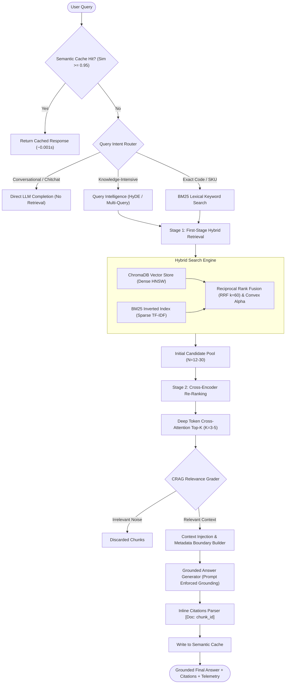
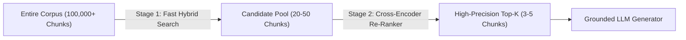
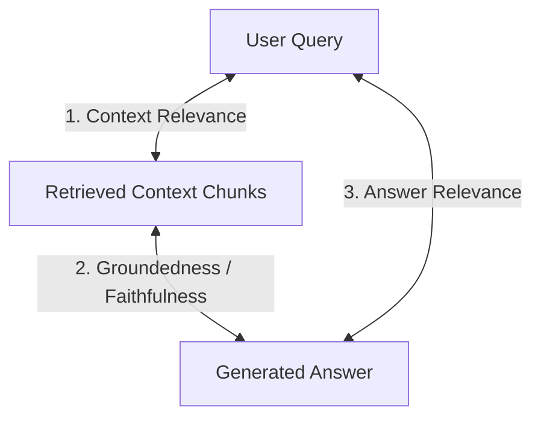

# Advanced RAG: Production-Ready Architectural Guide & Reference

A modular, enterprise-grade **Advanced Retrieval-Augmented Generation (RAG)** platform and deep architectural manual covering every phase of the modern retrieval lifecycle — from semantic chunking with metadata enrichment and hybrid search fusion to cross-encoder re-ranking, retrieval intelligence, and grounded factual synthesis.

---

## Architecture Overview



---

## Table of Contents
1. [Topic 1: Understanding Chunking and Overlap in Advanced RAG](#1-understanding-chunking-and-overlap-in-advanced-rag)
2. [Topic 2: Building a Document Chunking Strategy with Metadata](#2-building-a-document-chunking-strategy-with-metadata)
3. [Topic 3: Generating Embeddings for Document Chunks](#3-generating-embeddings-for-document-chunks)
4. [Topic 4: Building Semantic Search for Intelligent Retrieval](#4-building-semantic-search-for-intelligent-retrieval)
5. [Topic 5: Building Hybrid Search: Combining Keyword and Semantic Retrieval](#5-building-hybrid-search-combining-keyword-and-semantic-retrieval)
6. [Topic 6: Understanding Re-Ranking: Finding the Most Relevant Results](#6-understanding-re-ranking-finding-the-most-relevant-results)
7. [Topic 7: Building a Vector Store with ChromaDB](#7-building-a-vector-store-with-chromadb)
8. [Topic 8: Building Semantic Search with ChromaDB](#8-building-semantic-search-with-chromadb)
9. [Topic 9: Evaluating and Improving RAG Retrieval Quality](#9-evaluating-and-improving-rag-retrieval-quality)
10. [Topic 10: Building the Complete Advanced RAG Retrieval Pipeline](#10-building-the-complete-advanced-rag-retrieval-pipeline)
11. [Topic 11: Building the Final Answer Generator for Advanced RAG](#11-building-the-final-answer-generator-for-advanced-rag)
12. [Topic 12: Building the Final Runner for Our Advanced RAG Application](#12-building-the-final-runner-for-our-advanced-rag-application)
13. [Topic 13: Building Retrieval Intelligence with Advanced RAG](#13-building-retrieval-intelligence-with-advanced-rag)
14. [Practical Demo Project Quickstart](#practical-demo-project-quickstart)
15. [REST API & Web UI Documentation](#rest-api--web-ui-documentation)

---

## 1. Understanding Chunking and Overlap in Advanced RAG

### The Chunking Dilemma
In any RAG system, the Large Language Model cannot ingest the entire corpus in a single prompt. Documents must be partitioned into smaller segments called **chunks**. The size and boundary strategy of these chunks dictate both retrieval precision and generative coherence:

- **Small Chunks (e.g., 50–150 tokens)**:
  - *Advantage*: High semantic density. The embedding represents a single focused concept without noise.
  - *Disadvantage*: Loss of contextual scope. Key antecedent references (e.g., pronouns like "it", "this architecture", "the aforementioned method") lose their referents.
- **Large Chunks (e.g., 1000–2000 tokens)**:
  - *Advantage*: Rich contextual background preserved within each passage.
  - *Disadvantage*: Semantic dilution. The embedding vector averages multiple disparate concepts, lowering cosine similarity with specific, targeted queries.
- **The "Lost in the Middle" Effect**:
  - Research (Liu et al., 2023) demonstrates that LLMs attend best to information at the very beginning and very end of the injected context window. Placing large, bloated chunks into the prompt causes the model to overlook critical facts embedded in the middle.

```
┌───────────────────────────────────────────────────────────────┐
│ Chunk 1 (Chars 0 to 500)                                      │
│ [The Raft consensus algorithm splits consensus into leader...]│
└──────────────────────────┬────────────────────────────────────┘
                           │ Overlap Window (Chars 400 to 500)
                           ▼
              ┌───────────────────────────────────────────────────────────────┐
              │ Chunk 2 (Chars 400 to 900)                                    │
              │ [...consensus into leader election and log replication...]    │
              └───────────────────────────────────────────────────────────────┘
```

### The Role of Overlap
When text is split naively at fixed intervals, sentences, formulas, or logical propositions are routinely severed across boundaries. **Overlap** acts as an information bridge:
- By configuring an overlap ratio of $15\%$ to $25\%$ of the chunk size, sentences truncated at the end of Chunk $N$ are preserved in their entirety at the start of Chunk $N+1$.
- **Sliding Window Stride Formulation**:
  $$\text{Stride} = \text{Chunk Size} - \text{Overlap}$$
  For example, with $\text{Chunk Size} = 500$ and $\text{Overlap} = 100$, the sliding window advances by $\text{Stride} = 400$ characters for each subsequent slice.

---

## 2. Building a Document Chunking Strategy with Metadata

### Structural Awareness vs Arbitrary Splitting
Production documents are rarely flat text; they are structured hierarchies consisting of Markdown titles, section headers, tables, code blocks, and footnotes. A production-grade chunking strategy respects this structure:

1. **Recursive Character Chunking**:
   Recursively splits using a priority hierarchy of separators:
   1. `\n\n` (Paragraph boundaries)
   2. `\n` (Line breaks)
   3. `. ` (Sentence terminators)
   4. `; `, `, ` (Clause delimiters)
   5. ` ` (Word boundaries)
   This ensures that splits occur at the highest possible structural boundary before resorting to finer token splits.

2. **Markdown Section-Aware Chunking**:
   Parses header tokens (`#`, `##`, `###`) to preserve section context. If a subsection fits within the maximum chunk size, it is preserved intact. If it exceeds the limit, it is recursively subdivided while attaching the hierarchical breadcrumb as metadata:
   $$\text{Section Path} = \text{"Architecture"} \to \text{"Vector Store"} \to \text{"HNSW"}$$

### Metadata Schema Design
Every chunk created in the system carries rich structured metadata to power downstream filtering, citation tracing, and Parent-Document retrieval:

```json
{
  "chunk_id": "rag_deep_dive_c003",
  "doc_id": "rag_deep_dive",
  "source": "rag_deep_dive.md",
  "chunk_index": 3,
  "total_chunks": 12,
  "char_start": 1240,
  "char_end": 1720,
  "token_count": 98,
  "section_heading": "Hybrid Search: Unifying BM25 and Dense Vectors",
  "section_path": "Deep Dive > Hybrid Search",
  "created_at": 1730800000.0,
  "strategy": "markdown_section"
}
```

---

## 3. Generating Embeddings for Document Chunks

### Dense Semantic Vector Space
An embedding model maps discrete textual tokens into a continuous vector space $\mathbb{R}^D$ where geometric proximity corresponds to semantic similarity.

```
       [High Cosine Similarity (~0.91)]
"How to configure vector database" ◄─────────► "Setting up ChromaDB persistence"
               │
               │ [Low Cosine Similarity (~0.12)]
               ▼
"Baking homemade sourdough bread"
```

### Vector Normalization & Cosine Similarity
When vectors $u, v \in \mathbb{R}^D$ are normalized to unit length using their Euclidean $L_2$ norm:
$$\hat{v} = \frac{v}{\|v\|_2} = \frac{v}{\sqrt{\sum_{i=1}^D v_i^2}}$$
the cosine similarity reduces directly to the inner dot product:
$$\text{Cosine Similarity}(\hat{u}, \hat{v}) = \hat{u} \cdot \hat{v} = \sum_{i=1}^D \hat{u}_i \hat{v}_i$$
This property allows vector databases to execute nearest-neighbor queries via high-speed SIMD matrix multiplications without computing square roots at query time.

### Multiprovider Architecture with Fallbacks
In production environments, external APIs may experience rate limiting or network latency. The `EmbeddingEngine` in this project implements an automatic multi-tier fallback:
1. **Tier 1 (Local Ollama)**: Queries local `qwen3-embedding:0.6b` with sub-10ms response times.
2. **Tier 2 (Google Gemini)**: Queries `text-embedding-004` via OpenAI-compatible endpoints.
3. **Tier 3 (Deterministic Semantic Fallback)**: Generates a high-dimensional pseudo-semantic vector representation based on n-gram hashing to guarantee that offline testing and CI/CD pipelines never fail.

### In-Memory Embedding Cache
Computing vector embeddings is computationally expensive. The engine incorporates an in-memory SHA-256 content-addressable cache:
$$\text{Key} = \text{SHA256}(\text{Text.strip()})$$
Repeated queries or chunk re-indexing operations hit the cache instantly with $O(1)$ complexity.

---

## 4. Building Semantic Search for Intelligent Retrieval

### Dense Semantic Retrieval Principles
Traditional keyword search fails when users ask questions using different vocabulary than the indexed documents (the **vocabulary mismatch problem**):
- *Query*: "What are the storage requirements for vector indexing?"
- *Document*: "Memory footprint and RAM allocation for HNSW graph nodes."

Semantic search bridges this gap by mapping both the query and the documents into the shared embedding manifold. Documents discussing related concepts cluster together regardless of exact phrasing or language synonyms.

### Vector Distance Formats
| Metric | Formula | Value Range | Properties |
| :--- | :--- | :--- | :--- |
| **Cosine Similarity** | $\frac{u \cdot v}{\|u\| \|v\|}$ | $[-1.0, 1.0]$ | Invariant to document length or magnitude |
| **Cosine Distance** | $1 - \text{Cosine Similarity}$ | $[0.0, 2.0]$ | Standard distance in ChromaDB (`hnsw:space: cosine`) |
| **Euclidean ($L_2$)** | $\sqrt{\sum (u_i - v_i)^2}$ | $[0.0, \infty)$ | Sensitive to vector magnitude unless normalized |
| **Dot Product (IP)** | $\sum u_i v_i$ | $(-\infty, \infty)$ | Maximum speed; identical to cosine for unit vectors |

---

## 5. Building Hybrid Search: Combining Keyword and Semantic Retrieval

### Why Dense Retrieval Alone Is Not Enough
While dense semantic vectors excel at abstract concepts, they perform poorly on:
1. Exact product numbers or SKUs (e.g., `Part-9948-AB`)
2. Software error codes and exception names (e.g., `NullPointerException`, `HTTP 502`)
3. Code symbols, method names, and identifiers (e.g., `calculate_mrr()`)
4. Rare acronyms and proper nouns (e.g., company names, technical standards)

**Hybrid Search** combines the precision of sparse lexical search (BM25) with the conceptual recall of dense vector search.

```
                       ┌───────────────────────────────┐
                       │          User Query           │
                       └──────────────┬────────────────┘
                                      │
               ┌──────────────────────┴──────────────────────┐
               ▼                                             ▼
┌──────────────────────────────┐              ┌──────────────────────────────┐
│ Dense Semantic Search (HNSW) │              │ Sparse Lexical Search (BM25) │
│ - Conceptual matches         │              │ - Exact keyword matches      │
│ - Synonyms & paraphrases     │              │ - SKUs, error codes, symbols │
└──────────────┬───────────────┘              └──────────────┬───────────────┘
               │                                             │
               │ Dense Rank / Score                          │ Sparse Rank / Score
               └──────────────────────┬──────────────────────┘
                                      ▼
                       ┌───────────────────────────────┐
                       │   Rank Fusion Engine (RRF)    │
                       │ RRF_Score = Σ 1 / (60 + Rank) │
                       └──────────────┬────────────────┘
                                      ▼
                       ┌───────────────────────────────┐
                       │ Unified Hybrid Candidate Pool │
                       └───────────────────────────────┘
```

### BM25 Okapi Algorithmic Formulation
The BM25 score of a document $D$ given query $Q = \{q_1, q_2, \dots, q_n\}$ is:
$$\text{Score}_{\text{BM25}}(D, Q) = \sum_{i=1}^n \text{IDF}(q_i) \cdot \frac{f(q_i, D) \cdot (k_1 + 1)}{f(q_i, D) + k_1 \cdot \left(1 - b + b \cdot \frac{|D|}{\text{avgdl}}\right)}$$
where:
- $f(q_i, D)$ is the term frequency of token $q_i$ in candidate chunk $D$.
- $|D|$ and $\text{avgdl}$ are the chunk length and average chunk length in the corpus.
- $k_1$ controls term frequency saturation (typically $1.2 \le k_1 \le 2.0$). As $f(q_i, D)$ increases, the marginal score gain plateaus.
- $b$ controls length normalization (typically $b = 0.75$). Prevents long documents from dominating purely due to word count.
- $\text{IDF}(q_i) = \ln\left(\frac{N - n(q_i) + 0.5}{n(q_i) + 0.5} + 1\right)$, dampening common stopwords and rewarding rare, discriminative terms.

### Fusion Strategies: RRF vs Convex Combination
1. **Reciprocal Rank Fusion (RRF)**:
   $$\text{RRF}(d) = \sum_{m \in M} \frac{1}{k + r_m(d)}$$
   where $k \approx 60$ and $r_m(d)$ is the integer rank position of document $d$ in retrieval system $m \in \{\text{Dense}, \text{Sparse}\}$.
   - *Key Advantage*: Does not require calibrating or normalizing scores across differing distributions.

2. **Convex Linear Combination (Alpha Weighting)**:
   $$\text{Score}_{\text{fused}}(d) = \alpha \cdot \bar{S}_{\text{dense}}(d) + (1 - \alpha) \cdot \bar{S}_{\text{sparse}}(d)$$
   where $\bar{S}$ is Min-Max normalized into $[0, 1]$:
   $$\bar{S} = \frac{S - S_{\min}}{S_{\max} - S_{\min} + \epsilon}$$
   - Setting $\alpha = 1.0$ yields pure dense search.
   - Setting $\alpha = 0.0$ yields pure BM25 lexical search.
   - Setting $\alpha = 0.5$ provides balanced hybrid retrieval.

---

## 6. Understanding Re-Ranking: Finding the Most Relevant Results

### The Two-Stage Retrieval Paradigm
In large corpora, computing deep transformer cross-attention between a user query and millions of chunks is computationally impossible within interactive latency budgets ($<200\text{ms}$). Advanced RAG solves this with a **Two-Stage Architecture**:

1. **Stage 1 (Retrieval / Candidate Selection)**: Fast, high-recall hybrid search retrieves $N \approx 20\text{--}50$ candidate chunks in milliseconds.
2. **Stage 2 (Re-Ranking / Precision Distillation)**: A powerful cross-encoder re-evaluates only those $N$ candidate passages, producing a distilled top-$K \approx 3\text{--}5$ context for the generator.



### Bi-Encoders vs Cross-Encoders
- **Bi-Encoder (Embedding Models)**:
  - Embeds Query and Document *separately*: $\vec{q} = \text{Encoder}(Q)$ and $\vec{d} = \text{Encoder}(D)$.
  - Fast dot product: $\text{sim} = \vec{q} \cdot \vec{d}$.
  - *Limitation*: No token-level interaction. Cannot detect subtle qualifiers, negation, or syntactic conditions.
- **Cross-Encoder (Re-Rankers)**:
  - Feeds both Query and Document together into a single transformer:
    $$\text{Input} = [\text{CLS}] \circ Q \circ [\text{SEP}] \circ D \circ [\text{SEP}]$$
  - Every word in the query attends directly to every word in the candidate chunk via all-to-all cross-attention layers.
  - Detects semantic alignment with significantly higher precision.

---

## 7. Building a Vector Store with ChromaDB

### ChromaDB Architecture
ChromaDB provides an open-source, lightweight, embedded vector database tailored for AI applications:
- **Persistent Storage**: Backed by SQLite for metadata, document catalogs, and inverted index properties.
- **HNSW Vector Store**: Backed by `hnswlib` for high-throughput C++ approximate nearest neighbor indexing.
- **Client Modes**:
  - `chromadb.PersistentClient(path="./chroma_db")` for on-disk persistence.
  - `chromadb.EphemeralClient()` for fast in-memory execution and unit testing.

### Metadata Filtering Queries
ChromaDB allows filtering candidate chunks by structured metadata before or during distance evaluation:
```python
# Metadata filter query
results = collection.query(
    query_embeddings=[query_vector],
    n_results=5,
    where={
        "$and": [
            {"source": {"$eq": "rag_deep_dive.md"}},
            {"token_count": {"$gt": 40}}
        ]
    }
)
```

---

## 8. Building Semantic Search with ChromaDB

### Approximate Nearest Neighbors (ANN) vs Exact KNN
- **Exact k-NN**: Computes vector distance against every vector in the index. Time complexity is $O(N \cdot D)$. For $1,000,000$ chunks, this requires seconds per query.
- **Approximate Nearest Neighbors (ANN)**: Trades a negligible margin of precision ($<1\%$) for logarithmic search time ($O(\log N)$).

```
Layer 2 (Sparse, Long Jumps)  ● ───────────────────────────► ●
                              │                              │
Layer 1 (Medium Granularity)  ● ────────────► ● ───────────► ●
                              │               │              │
Layer 0 (Dense, Fine Search)  ● ──► ● ──► ● ──► ● ──► ● ──► ● ──► Target Nearest Neighbor
```

### Hierarchical Navigable Small World (HNSW) Principles
HNSW constructs a multi-layer graph reminiscent of a skip list:
1. **Top Layers**: Sparse connectivity with long-range edges for high-velocity traversals across broad vector regions.
2. **Bottom Layers**: High-density connectivity with short-range edges for fine-grained local neighborhood exploration.
3. **Key HNSW Hyperparameters**:
   - `M`: Maximum number of bidirectional links per node (typically $16 \le M \le 64$).
   - `efConstruction`: Size of dynamic candidate list evaluated during graph construction. Higher values yield higher recall graphs at the expense of indexing time.
   - `efSearch`: Size of dynamic candidate list during query execution. Allows real-time trade-offs between latency and recall.

---

## 9. Evaluating and Improving RAG Retrieval Quality

### Information Retrieval (IR) Evaluation Metrics
To prevent retrieval degradation as corpora expand, the evaluation framework implements:

1. **Hit Rate @ K**:
   Binary metric measuring whether the ground-truth relevant chunk appears in the top-$K$ candidates:
   $$\text{Hit Rate @ K} = \frac{1}{|Q|} \sum_{q=1}^{|Q|} \mathbb{I}(\text{rank}_q \le K)$$

2. **Mean Reciprocal Rank (MRR @ K)**:
   Measures where the first relevant result appeared, rewarding systems that place correct answers at Rank 1:
   $$\text{MRR @ K} = \frac{1}{|Q|} \sum_{q=1}^{|Q|} \frac{1}{\text{rank}_q} \quad (\text{if } \text{rank}_q \le K, \text{ else } 0)$$

3. **Normalized Discounted Cumulative Gain (NDCG @ K)**:
   Applies a logarithmic discount penalty to relevant items retrieved at lower ranks:
   $$\text{DCG @ K} = \sum_{i=1}^K \frac{2^{\text{rel}_i} - 1}{\log_2(i + 1)}, \quad \text{NDCG @ K} = \frac{\text{DCG @ K}}{\text{IDCG @ K}}$$

### The RAG Triad
Adopted from Ragas and TruLens, the RAG Triad verifies the three critical interfaces of RAG:



1. **Context Relevance**: Measures the proportion of retrieved chunks that contain semantic signal directly relevant to the user query (detecting context bloat and noise).
2. **Groundedness / Faithfulness**: Zero-hallucination verification. Every factual proposition in the generated answer must be inferable directly from the provided context chunks.
3. **Answer Relevance**: Verifies that the synthesis directly answers the user's specific question without wandering off-topic.

---

## 10. Building the Complete Advanced RAG Retrieval Pipeline

The complete pipeline chains all modules into a unified multi-stage flow with end-to-end timing telemetry:

```python
from src.pipeline import AdvancedRAGPipeline

# Initialize pipeline
pipeline = AdvancedRAGPipeline()

# Ingest document
pipeline.ingest_document(
    doc_id="system_arch",
    text=document_content,
    source_name="system_arch.md"
)

# Execute full RAG pipeline
response = pipeline.run(
    query="How does Reciprocal Rank Fusion combine dense and lexical search?",
    top_k=4,
    candidate_k=15,
    hybrid_method="rrf",
    use_cache=True,
    use_multiquery=False,
    use_hyde=False
)

print("Answer:", response["answer"])
print("Citations:", response["citations"])
print("Telemetry:", response["telemetry"])
```

### Telemetry & Stage Profiling
Each pipeline execution collects timing metrics for every sub-stage:
```json
{
  "routing_sec": 0.0004,
  "query_transformation_sec": 0.0001,
  "hybrid_retrieval_sec": 0.0078,
  "reranking_sec": 0.0032,
  "crag_filter_sec": 0.0006,
  "generation_sec": 0.8120,
  "pipeline_total_sec": 0.8241
}
```

---

## 11. Building the Final Answer Generator for Advanced RAG

### Grounded Prompt Engineering
The Answer Generator uses structured delimiter tags to encapsulate context chunks. This enforces strict citation hygiene and prevents prompt injection attacks:

```
You are an Advanced RAG Assistant with strict factual grounding.
Rules:
1. Answer using ONLY the provided CONTEXT CHUNKS.
2. For every factual statement, cite the chunk ID in brackets: [Doc: chunk_id].
3. If the context does not contain the answer, state:
   "Based on the provided documents, I do not have enough information to answer this question."

QUESTION:
{user_query}

CONTEXT CHUNKS:
--- [START CHUNK: rag_c001 | Source: rag_deep_dive.md | Section: Chunking] ---
{chunk_text_1}
--- [END CHUNK: rag_c001] ---

GROUNDED ANSWER (with citations):
```

### Citation Extraction & Provenance Linking
The generator parses citations such as `[Doc: rag_deep_dive_c003]` and returns structured metadata objects linking each claim to its exact file name, section path, text preview, and re-rank score.

---

## 12. Building the Final Runner for Our Advanced RAG Application

The `AdvancedRAGRunner` provides an operational interface for the application:
- Auto-ingests sample knowledge bases on boot if the vector store is uninitialized.
- Collects corpus health metrics (chunk counts, document sources, token estimates).
- Powers both the interactive terminal CLI (`cli.py`) and the production FastAPI web server (`app.py`).

---

## 13. Building Retrieval Intelligence with Advanced RAG

### 1. Query Intent Routing
Classifies incoming prompts to avoid unnecessary vector searches:
- `DIRECT_LLM`: Conversational chitchat ("Hello", "Who are you?") is answered immediately by the LLM with $0\text{ms}$ retrieval overhead.
- `HYBRID_KEYWORD_HEAVY`: Queries containing exact error codes, SKUs, or quoted strings boost lexical BM25 weights.
- `HYBRID_RAG`: Standard knowledge-intensive questions invoke full hybrid search.

### 2. Multi-Query Expansion
Generates alternative formulations of the user's query using varied synonyms and technical phrasing. Chunks retrieved across all formulations are merged and deduplicated, hedging against query phrasing bias.

### 3. Hypothetical Document Embeddings (HyDE)
When a query is brief or abstract, question embeddings often occupy a different region of vector space than declarative answer paragraphs. HyDE instructs the LLM to generate a synthetic hypothetical answer passage, embeds that passage, and performs *doc-to-doc* retrieval in vector space.

### 4. Corrective RAG (CRAG) Relevance Grader
Before context is passed to the answer generator, an internal evaluator grades candidate chunks. Distractor chunks with low relevance scores are pruned, preventing context window pollution.

### 5. Semantic Caching
Maintains a cache of recent query embeddings. When a new query has a cosine similarity $\ge 0.95$ with a cached query, the system returns the cached answer in $\approx 1\text{ms}$ with zero API calls.

---

## Practical Demo Project Quickstart

### Prerequisites
- Python 3.10+
- Installed virtual environment with dependencies (`fastapi`, `uvicorn`, `chromadb`, `openai`, `requests`, `numpy`, `python-dotenv`)

### 1. Configuration (`.env`)
Create or verify your `.env` file in the project directory:
```bash
# Local Ollama
BASE_URL=http://localhost:11434/v1
API_KEY=ollama
MODEL=qwen3:4b
EMODEL=qwen3-embedding:0.6b

# Optional: Google Gemini (High Speed Completion)
GEMINI_BASE_URL=https://generativelanguage.googleapis.com/v1beta/openai/
API_KEY_G=your_gemini_api_key_here
GEMINI_MODEL=gemini-2.5-flash
```

### 2. Run Automated Test Suite (All 13 Topics)
Run the automated test suite verifying every component:
```bash
./run.sh test
```
*Expected output: `Ran 9 tests in ~15s ... OK`*

### 3. Launch Interactive Terminal CLI
```bash
./run.sh cli
```
Offers an interactive menu to test each topic individually:
```
Select a topic to demonstrate:
  1. Topic 1 & 2: Chunking Strategy & Overlap Inspector
  2. Topic 3: Generate & Compare Vector Embeddings
  3. Topic 4 & 8: Semantic Vector Search (ChromaDB + HNSW)
  4. Topic 5: Lexical Search (BM25 Okapi)
  5. Topic 5: Hybrid Search (BM25 + Semantic Search via RRF & Convex)
  6. Topic 6: Re-Ranking Candidates (Cross-Encoder Scoring)
  7. Topic 9: Evaluation Benchmark (Hit Rate, MRR, NDCG, RAG Triad)
  8. Topic 10 & 13: Retrieval Intelligence (Routing, HyDE, Multi-Query, CRAG)
  9. Topic 11 & 12: Interactive Grounded Q&A Runner
  10. Run Full Pipeline Validation (All 13 Topics)
```

### 4. Launch the Web Platform & Interactive Dashboard
```bash
./run.sh
```
Open your browser at:
- **Interactive Web UI**: `http://localhost:8001`
- **Swagger REST API**: `http://localhost:8001/docs`

---

## REST API & Web UI Documentation

### Endpoints Reference

#### `POST /api/query`
Executes the full Advanced RAG pipeline.
```bash
curl -X POST http://localhost:8001/api/query \
  -H "Content-Type: application/json" \
  -d '{
    "query": "How does Reciprocal Rank Fusion combine search rankings?",
    "top_k": 3,
    "hybrid_method": "rrf",
    "use_cache": true,
    "use_multiquery": false,
    "use_hyde": false
  }'
```

#### `POST /api/search/hybrid`
Inspects hybrid retrieval candidates with score breakdowns.
```bash
curl -X POST http://localhost:8001/api/search/hybrid \
  -H "Content-Type: application/json" \
  -d '{
    "query": "BM25 term frequency saturation",
    "method": "rrf",
    "top_k": 5
  }'
```

#### `POST /api/evaluate`
Triggers the automated IR and RAG Triad benchmark.
```bash
curl -X POST http://localhost:8001/api/evaluate
```

#### `POST /api/ingest/file`
Uploads and indexes a new Markdown, TXT, or PDF document.
```bash
curl -X POST http://localhost:8001/api/ingest/file \
  -F "file=@sample_data/rag_deep_dive.md"
```

---

## Project Structure

```
project_rag/
├── README.md                          # Comprehensive 13-topic guide and reference
├── requirements.txt                   # Dependency specifications
├── .env.example                       # Sample environment configuration
├── config.py                          # Unified configuration management
├── run.sh                             # Executable launcher (server, cli, test)
├── cli.py                             # Interactive terminal runner
├── app.py                             # FastAPI REST API & Swagger server
├── static/                            # Web platform frontend
│   ├── index.html                     # 5-tab interactive dashboard
│   ├── app.js                         # Dynamic UI logic, citations, telemetry
│   └── style.css                      # Modern dark/slate theme
├── sample_data/                       # Enterprise knowledge base documents
│   ├── rag_deep_dive.md
│   ├── vector_search_and_hnsw.md
│   └── production_rag_patterns.md
├── src/                               # Modular Advanced RAG engine
│   ├── __init__.py
│   ├── chunking.py                    # Topics 1 & 2: Recursive & Markdown chunking with metadata
│   ├── embeddings.py                  # Topic 3: Multiprovider embeddings, L2 norm, vector caching
│   ├── vector_store.py                # Topic 7: ChromaDB persistent vector database wrapper
│   ├── keyword_search.py              # Topic 5: BM25 Okapi sparse lexical search engine
│   ├── semantic_search.py             # Topics 4 & 8: Semantic vector search with HNSW
│   ├── hybrid_search.py               # Topic 5: RRF & Convex Combination hybrid fusion
│   ├── reranker.py                    # Topic 6: Cross-encoder token cross-attention re-ranker
│   ├── evaluation.py                  # Topic 9: Hit Rate@K, MRR@K, NDCG@K & RAG Triad
│   ├── retrieval_intelligence.py      # Topics 10 & 13: Query routing, HyDE, Multi-Query, CRAG, Cache
│   ├── generator.py                   # Topic 11: Grounded answer generator with citations & guardrails
│   ├── pipeline.py                    # Topic 10: Complete multi-stage RAG pipeline
│   └── runner.py                      # Topic 12: Production facade and lifecycle orchestrator
└── tests/
    ├── __init__.py
    └── test_rag_pipeline.py           # Comprehensive automated unit & integration test suite
```

